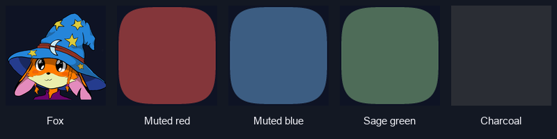
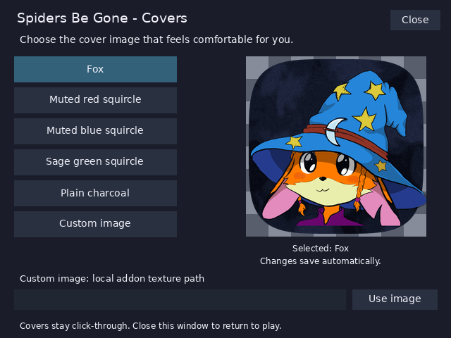

# Choose your cover image (v0.3.8)

Run `/as config` to open the cover picker. Click a preset to preview it
and update every cover immediately. The choice is saved in addon settings
and survives reloads; the fox is the default for new or migrated settings.
The window appears only when requested. Close it to return to play.

Covers are permanently click-through and attach only to nameplates. They
cannot be moved by hand or restored from a saved screen layout. Changing an image while
the addon is disabled keeps it disabled. Tracking, cover sizing and the
1.75-second look-away warning are independent of the selected picture.

## Included choices



| Choice | Appearance | Command |
| --- | --- | --- |
| Fox | Supplied illustration on a navy-toned camouflage squircle card, original colors, fitted in proportion | `/as cover fox` |
| Muted red | Red camouflage squircle, similar in spirit to the previous cover | `/as cover red` |
| Muted blue | Blue camouflage squircle | `/as cover blue` |
| Sage green | Green camouflage squircle | `/as cover sage` |
| Plain charcoal | Dark grey camouflage squircle | `/as cover charcoal` |

For simple backgrounds, these are starting suggestions to try according to
personal preference. They have no animation and no spider imagery. Since
v0.3.7 every preset is a 32-bit RGBA **camouflage squircle** with
**transparent rounded corners**: the world shows through the corners only,
while the shape itself is a busy three-tone pattern of its color plus fine
grain. The camouflage is deliberate — this client fades nameplates (and
their children, i.e. the covers) with distance, and a flat fill lets a
spider's outline trace through that fade while a busy pattern does not.
Since v0.3.8 the fox sits on a navy-toned **camouflage** squircle card,
so the open areas around the illustration are solid backing rather than
transparency (v0.3.6 cut them to holes and the result read as too
see-through). Picture colors are preserved. The picker preview shows a
checker behind every image, so corner transparency is visible there before
you commit. Custom images keep a navy backing behind them (minimum coverage
floor); the setup and troubleshooting guide for custom images is in the
[README](../README.md#custom-cover-images--setup-and-troubleshooting).
All covers are fully opaque (see [Opacity](#opacity-removed-in-v038)).
Models can still extend beyond an undersized or misaligned cover; the
nameplate-tracking limitations still apply.

`/as cover` lists choices and the selected image. `/as options` is
an alias for the picker. If this client's window APIs reject the panel,
the addon prints command-based instructions and tracking continues.

Offline layout preview (client fonts/rendering may differ):



## Opacity (removed in v0.3.8)

Covers are always **fully opaque**. The 80–100% buttons and the
`/as opacity` command are gone. The reason is not a matter of taste:
this client fades nameplates with distance, and a cover is a child of the
nameplate, so it fades with it no matter what vertex alpha the addon sets.
A preference that cannot do what it says is worse than none, so v0.3.8
removes the control, the saved value and the command entirely. A saved
opacity value from an older version is dropped on load; `/as opacity`
now reports the retired subcommand and changes nothing. The camouflage
presets (and the fox card) are the real answer to the distance fade: a
busy pattern makes a spider's outline much harder to trace than a flat
fill. The corpse warning is not faded either; it is an independent
frame.

The picker still creates no native Slider frame: a Slider captures the
mouse for dragging, and on this client a click in the picker left the
cursor frozen, so v0.3.5 removed it. Covers remain permanently
click-through; only the explicit configuration window accepts clicks, and
its buttons hold no mouse state. The button-only picker still needs partner
validation.

## Use your own image

Prepare a local square TGA texture in the addon's custom folder, for
example:

```text
<game folder>/Interface/AddOns/ArachnaphobiaShield/Custom/flower.tga
```

Then open the picker, keep the prefilled
`Interface\AddOns\ArachnaphobiaShield\Custom\` prefix, add the file name and
click **Use image** (the field prefills the required prefix since v0.4.5; a
bare file name without the prefix is rejected), or enter:

```text
/as cover custom Interface\AddOns\ArachnaphobiaShield\Custom\flower.tga
```

Since v0.3.8 the validated path is strict: a custom image must live under
`Interface\AddOns\ArachnaphobiaShield\Custom\`. The empty folder ships in the
release zip (fresh installs get it since v0.4.5); its contents are
git-ignored and never packaged, so personal images stay outside addon
updates. When updating, extract the zip over the existing folder (or
re-copy your images) so your images survive. Legacy `MyCovers` paths from
older versions are rejected on load and the selection falls back to the
fox. `/as cover custom` reselects the last saved custom path. Choose a
bundled preset at any time to switch back.

The addon reads only a local `.tga` texture through the game's normal UI
API. The picker does not browse Windows files, download images or upload
anything. Windows paths and web addresses are rejected. To use a PNG or
JPEG illustration, convert it first with the included local helper:

```powershell
uv run --with pillow python tools/import_cover.py "C:\Pictures\flower.png" --output "C:\Games\WoW\Interface\AddOns\ArachnaphobiaShield\Custom\flower.tga"
```

Replace those example paths with your own. The helper reads the source
without modifying it, fits the entire illustration into a 512 x 512 square
without stretching/cropping, composites transparent areas over dark blue,
and writes an uncompressed 24-bit RGB TGA plus a PNG preview alongside it.
Image processing stays local; `uv` may download the Pillow dependency.
If you use another converter, a 512 x 512 uncompressed RGB TGA is the format
used and checked for the included fox. Transparent custom images receive
the addon's opaque backing too.

Fully exit and reopen the game after adding a new texture, then check the
picker's preview. This is a conservative installation step: new-file reload
behavior has not been verified on this Forever client. A reported texture
failure falls back to the fox. Some clients accept a missing filename and
display a placeholder instead; Lua cannot reliably detect that, so use the
preview to confirm the image appears. A solid backing still hides the area
behind transparent portions of the cover.

Personal custom files are not part of release packages. The packaging tool
uses an explicit list of approved bundled images, and `ArachnaphobiaShield/Custom/`
is ignored by Git.

## Additional examples and maintenance

The preset list in `ArachnaphobiaShield/Appearance.lua` drives the buttons and
selection handler. To ship another approved illustration, prepare its TGA,
add a preset entry, add the filename to `tools/package_addon.py`, and
regenerate the package. Changing a user's custom image requires no code
changes. Supplied artwork needs permission before publication.

`tools/make_backgrounds.py` regenerates the four camouflage squircles, the
four 8×8 picker UI textures and `cover-backdrop.tga`; `tools/make_art.py`
regenerates only the addon icon. Neither overwrites the supplied fox.
`tools/make_cover_alpha.py` re-cuts the fox import and places it on the
camo card; `tools/render_config_preview.py` re-renders
[art/config_preview.png](art/config_preview.png); and
`tools/make_choices_preview.py` re-renders
[art/cover_choices.png](art/cover_choices.png). The supplied fox is included with the user's
explicit permission to publish it with this addon. No NoSpider artwork is
used.

The picker uses ordinary addon-owned Button/EditBox frames, without changing
protected game frames. The Forever snapshot's generated
[EditBox API documentation](https://github.com/Gethe/wow-ui-source/blob/b401e0332adfbf0460d319b06d8ea29279a941f1/Interface/AddOns/Blizzard_APIDocumentationGenerated/SimpleEditBoxAPIDocumentation.lua)
documents the text/focus methods. The full picker has offline behavioral
coverage; its native rendering and input still require live-client validation.
